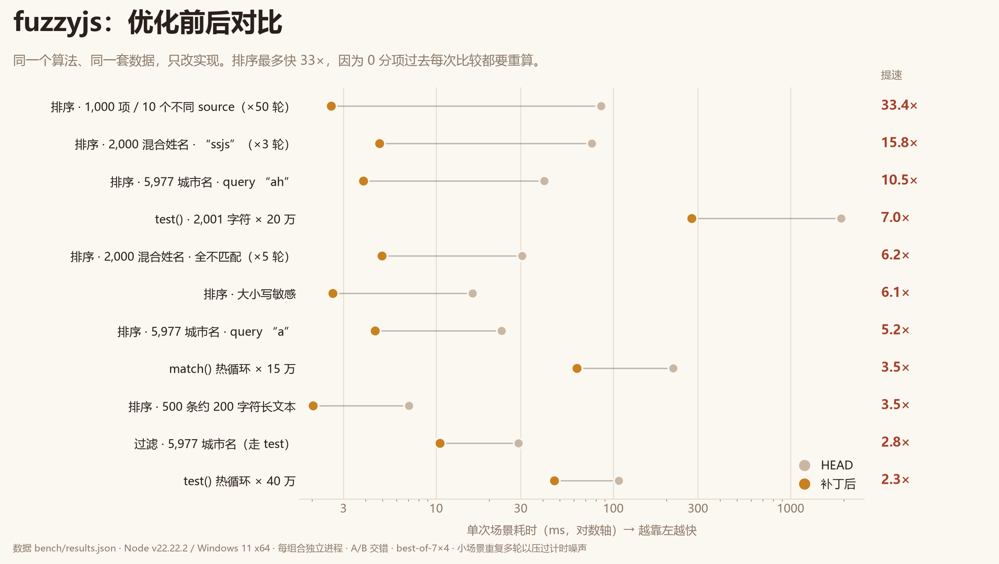
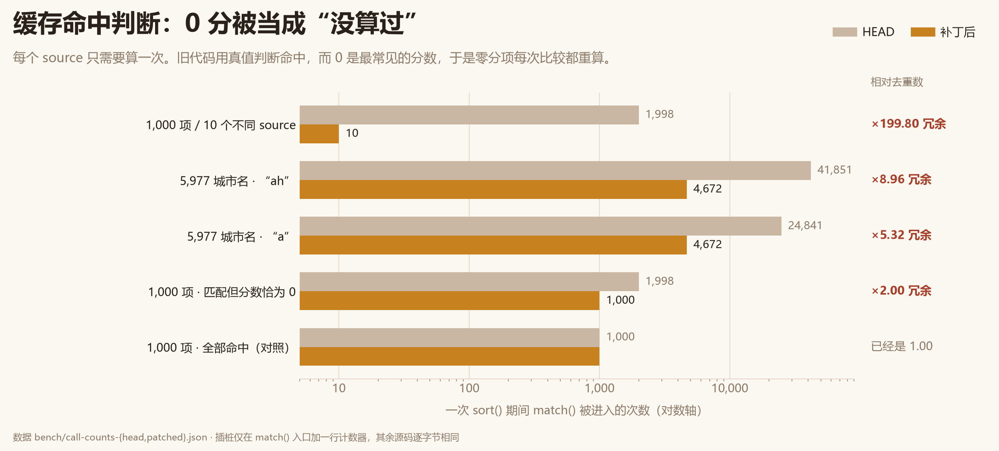

# fuzzyjs 性能优化报告

> 本文件是这个补丁的 README：改了什么、为什么这么改、怎么验证、怎么复现。
> 补丁文件 `fuzzyjs-performance.patch` 只包含 `src/` 与 `README.md`，可以直接 `git apply`；许可证情况见 `LICENSE_NOTES.md`。

- 上游：`gjuchault/fuzzyjs` @ `ffd9898`（2023-07-12 最后一次推送，`main`）
- 运行环境：Windows 11 x64 · Node `v22.22.2` · 16 逻辑核
- 结论口径：所有加速比都是**同一份算法改动前后**的对比，不是"和暴力实现比"

## 结论

`sort()` 的分数缓存用真值判断决定是否命中，而 `0` 恰好是最常见的分数——于是缓存对大多数数据完全失效。这是本次唯一的主因，修掉之后排序快 3.5–33 倍。另外三处（逐字符 `normalize`、ASCII 预处理、`test()` 扫完整串）分别再贡献 1.1–6.4 倍。

每一条判断都有可复现的证据：调用次数插桩、Unicode 穷举等价、6 万次随机差分。没有一条结论靠"看起来很合理"。

| 场景 | HEAD | 补丁后 | 加速 |
|---|---:|---:|---:|
| `sort` 5,977 条城市名（query `"ah"`） | 40.8 ms | 3.88 ms | **10.5×** |
| `sort` 2,000 条混合姓名（大小写 / 重音 / 重复 / 大面积未匹配，×3 轮） | 75.5 ms | 4.78 ms | **15.8×** |
| `sort` 1,000 项，只有 10 个不同 source（×50 轮） | 85.4 ms | 2.56 ms | **33.4×** |
| `sort` 500 条长文本（约 200 字符） | 7.03 ms | 2.02 ms | **3.5×** |
| `filter` 5,977 条城市名 | 29.2 ms | 10.5 ms | **2.8×** |
| `match()` 热循环 15 万次 | 217 ms | 62.3 ms | **3.5×** |
| `test()` 热循环 40 万次 | 107 ms | 46.4 ms | **2.3×** |
| `test()` 2,001 字符串 × 20 万次 | 1,927 ms | 277 ms | **7.0×** |

（"×N 轮"表示该场景把整个操作重复了 N 次再计时。几毫秒的小场景如果只跑一次，计时器噪声会盖过信号。）



图上每个点都是一次真实测量；横轴是对数刻度，左边更快。数据来自 `bench/results.json`，图片由 `bench/plot.py` 直接读取该 JSON 生成——不存在"手工画上去"的数字。

## 1. 定位过程

不是先读代码猜瓶颈，而是先数"到底算了几次"。

### 1.1 零分数被判成缓存未命中（主因）

上游 `src/array.ts` 的实现：

```ts
const cachedLeftMatch = cacheMap.get(leftSource);
const leftScore = cachedLeftMatch
  ? cachedLeftMatch // ← 0 会走到 else 分支
  : match(query, leftSource, { withScore: true, caseSensitive }).score;
```

`Map.get()` 返回 `0` 时，`0 ? a : b` 取的是 `b`。而 `match()` 的约定是：

- 完全不匹配 → `score: 0`
- 匹配了、但加分被周围的 `-1` 扣光 → 也是 `0`（例：`"A"` 是 leading 得 +10，后面跟十个非匹配字符各 −1）

所以只要某个 source 的分数是 `0`，它每次参与比较都会被重新算一遍。在一个过滤结果列表里，"大部分项不匹配"是常态而不是边缘情况——**这条路径就是主路径**。

插桩验证：在一份与仓库逐字节相同的源码副本里，只在 `match()` 入口加一个计数器，然后跑同样的排序。`distinct` 是理论上需要的计算次数（每个不同 source 一次）。

| 语料 | n | distinct | HEAD 调用次数 | 每 source | 补丁后 | 每 source |
|---|---:|---:|---:|---:|---:|---:|
| cities，query `"ah"` | 5,977 | 4,672 | 41,851 | **8.96** | 4,672 | 1.00 |
| cities，query `"a"` | 5,977 | 4,672 | 24,841 | **5.32** | 4,672 | 1.00 |
| cities，query `"zzz"` | 5,977 | 4,672 | 11,952 | **2.56** | 4,672 | 1.00 |
| cities，query `"new york"` | 5,977 | 4,672 | 12,064 | **2.58** | 4,672 | 1.00 |
| 1,000 项 / 10 个不同 source | 1,000 | 10 | 1,998 | **199.80** | 10 | 1.00 |
| 1,000 个不同 source，全部命中 | 1,000 | 1,000 | 1,000 | 1.00 | 1,000 | 1.00 |
| 1,000 个不同 source，分数恰为 0 | 1,000 | 1,000 | 1,998 | **2.00** | 1,000 | 1.00 |

三行对照说明问题只出在 `0` 上：

- 4,672 个不同 source、大量零分 → 算了 41,851 次，**8.96 倍冗余**
- 只有 10 个不同 source、全部零分 → 算了 1,998 次，**199.8 倍冗余**
- 1,000 个不同 source、全部命中且分数非 0 → 正好 1,000 次，**1.00 倍**

最后一行是关键反证：缓存本身是好的，坏的只是"命中判断"。



注意最下面那行对照：全部命中且分数非 0 时，旧版就已经是 1.00——所以问题不在缓存，只在"0 算不算命中"。图上条形是 `bench/call-counts-{head,patched}.json` 的原始读数，插桩只加了 `match()` 入口的一行计数器。

### 1.2 每个字符都要 `normalize()` 一次

`src/utils/isLeading.ts`：

```ts
const isCharLeading = char.toUpperCase() === char && /\w/.test(toLatin(char));
```

`toLatin` 是 `normalize("NFD")` + 正则替换。它在 `match()` 的逐字符循环里被调用，也就是**每个字符付一次字符串规范化 + 一次正则**。而对 ASCII 字符来说这两步都是恒等变换：ASCII 没有分解形式，也不落在组合附加符号区 `U+0300–U+036F`。

单次 `match()` 里这个开销占比很高——`match:hot` 场景（25 字符左右的字符串）基线是 215 ms / 15 万次 ≈ 1.43 µs，对一个纯比较循环来说太慢了。

### 1.3 `test()` 会扫完整个 source

`test()` 只返回布尔值，但循环边界是 `sourcePos < source.length`。query 的字符早就全部匹配上了，后面的字符还是要走完——对长字符串（比如一段描述、一个文件路径）是纯浪费。

### 1.4 一个不能碰的既有 bug（ragged loop）

`match()` / `test()` 的循环用 `source.length` 做边界，却用同一个下标去读 `reshapedSource`。当输入里含**显式的组合附加符号**（macOS 文件名常见的 NFD 形式，例如 `cafe\u0301`）时，`reshapedSource` 比 `source` 短，循环会读到 `undefined`，而它恰好等于 `reshapedQuery[queryPos]` 的 `undefined`，于是多记一次匹配。

这是既有 bug。修它会改变返回值，超出"只做性能"的范围，所以本次不动它——`test()` 的提前返回因此加了 `canStopEarly` 守卫（两个长度一致才启用），保证这类输入的结果逐字节不变。差分测试里专门放了 5 个这样的字符串。

## 2. 改动清单

四处，`src/` 下 +104 / −32 行（含注释与新增文件），净增 72 行。没有改公开 API、没有加依赖、没有改返回结构。

### 2.1 新增 `src/utils/scoreCache.ts`：用 `undefined` 判断未命中

```ts
export function createScoreCache(compute: ScoreComputer): ScoreComputer {
  const cache: Map<string, number> = new Map();

  return function score(source: string): number {
    const cached = cache.get(source);

    if (cached !== undefined) {
      return cached;
    }

    const computed = compute(source);
    cache.set(source, computed);

    return computed;
  };
}
```

- `match()` 的 `score` 只会是 `number`（`withScore: true` 时），因此 `undefined` 是唯一的"没算过"标记，`0`、负数都能正常命中。
- 顺手去掉了原来 `get` + `has` + `set` 的三次查表，每个 source 现在最多两次。
- 缓存生命周期仍是"一次 `sort()` 调用"，不跨调用、不全局，键仍是 **source 字符串**（不是对象身份），两个不同对象但同样的文本共享一次计算——与上游行为一致。

`sort()` 相应简化：

```ts
const scoreOf = createScoreCache((source) =>
  match(query, source, { withScore: true, caseSensitive: options.caseSensitive })
    .score as number
);

return (leftItem, rightItem) => {
  const leftScore = scoreOf(options.iterator(leftItem));
  const rightScore = scoreOf(options.iterator(rightItem));
  ...
};
```

### 2.2 `isLeading()` 的 ASCII 快路径

对 ASCII（`charCodeAt(0) < 128`）来说，`char.toUpperCase() === char && /\w/.test(toLatin(char))` 等价于"字符属于 `A-Z`、`0-9`、`_`"。这不是近似——`\w` 就是 `[A-Za-z0-9_]`，而 ASCII 经 NFD 与去附加符号后仍是自己。非 ASCII 原样走旧逻辑。

等价性用**穷举**验证，不是抽样：

```
node probe/isLeading-equivalence.js
checked 13369344 (prev, char) pairs, 0 mismatch(es)
```

覆盖 `U+0000`–`U+10FFFF` 全部码位（含代理区，因为 `source[pos]` 对星形平面字符取出的是半个代理对）× 12 种前一个字符（空、字母、分隔符、CJK、组合符号）。

### 2.3 `reshapeInput()` 的 ASCII 快路径

`normalize("NFD")` + `replace(/[\u0300-\u036f]/g, "")` 对纯 ASCII 是恒等变换。先用 `/[^\x00-\x7f]/` 判一次，ASCII 直接跳过两次全串遍历与两次分配。

代价对比（22 字符，300 万次）：

| 做法 | ns/次 |
|---|---:|
| 原样 normalize+replace+lower | 92.1 |
| ASCII 守卫 + lower | 40.1 |

（守卫本身 21.8 ns，`toLowerCase` 18.1 ns。）

### 2.4 `test()` 提前返回

```ts
if (canStopEarly && queryPos === reshapedQuery.length) {
  return true;
}
```

query 字符全部匹配后，剩下的字符只可能让 `queryPos` 继续加（或用 `undefined === undefined` 多记一次，见 1.4），不会改变布尔结果。`canStopEarly` 的存在是为了不碰 1.4 的既有 bug。

`match()` **没有**加同样的提前返回：它的分数是逐字符累加的（每个非匹配字符 −1），必须走完整串才能得到正确的分数。

## 3. 正确性验证

三层，从强到弱。全部可通过 `npm test` / 下面三条命令复现。

### 3.1 测试套件：48 个用例全绿

| 文件 | 数量 | 说明 |
|---|---:|---|
| 原有 8 个测试文件 | 37 | 一行未改 |
| `src/__tests__/sort.regression.test.ts` | 6 | 新增，见下 |
| `src/utils/__tests__/scoreCache.test.ts` | 5 | 新增，直接钉住"0 必须命中" |

新增的排序回归测试用**独立参照实现**做对照：用 `match()` 逐个算分、`Array.prototype.sort` 稳定排序，再和 `sort()` 的结果逐项比对。参照实现不经过被测缓存，缓存一旦返回错值，顺序就会对不上。覆盖：

- 大小写差异（`Alpha` / `alpha` / `ALPHA`）
- 重复字符串（同文本不同对象）
- 重音字符（`café`、`Ána` 等预组合形式）
- **分数恰好为 0 的匹配**（`"A"` + 10 个字符）与完全不匹配混排
- 300 项里大部分不匹配
- 空数组、单元素
- 两次 `sort()` 之间缓存不串味

`scoreCache` 的测试直接针对 bug 本身：`compute` 返回 `0` 时只允许被调用一次。

需要说清楚一件事：**"0 被当成未命中"这个 bug 不改变任何返回值**——重算一次得到的还是同一个 0。所以纯行为测试（包括我新加的排序回归测试）在打补丁前后都会通过，它们的价值是"保证没人把结果改坏"，不是"证明 bug 存在"。证明 bug 存在的证据只有一种：数调用次数（1.1 与 `probe/count.js`）。这也是为什么这次先把插桩做出来再动手。

### 3.2 差分测试：固定语料

```
node bench/compare.mjs baseline candidate
```

- 12 条 query × 2 种大小写模式 × 4 套语料（cities 5977 / 混合 2000 / 重复 1000 / 长文本 500）的 `sort` 顺序与 `filter` 结果
- 12 × 2 × 2（`withScore`）× 120 个 source 的 `match` **完整结果对象**（`match` / `score` / `ranges` 全比）
- 5 个含组合附加符号的 ragged 字符串

结果：`identical`。

### 3.3 差分测试：随机 fuzz

```
node bench/fuzz.mjs baseline candidate 20000
```

```
60800 comparisons over 20000 random string pairs
result: identical
```

字母表包含 ASCII、预组合重音（`é É ü Ñ`）、显式组合符号（`\u0301`、`\u0308`）、CJK、emoji 代理对、土耳其语 `İ`/`ı`、连字 `fi`、分隔符与空串。`match`（含 `withScore` 两种）、`test`、`sort`（1–40 个元素的列表，含大量同分项）、`filter` 全部比对。

### 3.4 未被改变的东西

- 公开 API 与返回结构（`match` 仍返回 `ranges`）
- 分数计算规则（`defaultStrategy` 未动）
- 排序的**稳定性**：同分项保持输入顺序（JS 的 `sort` 自 2019 起稳定，测试覆盖）
- 抛错行为：非字符串参数仍在同一位置抛 `TypeError`
- ragged 输入的既有结果（见 1.4）

## 4. 性能

### 4.1 方法

三条纪律，都是为了不让测量本身变成结论：

1. **每个 (实现, 场景) 组合独占一个 Node 进程**。同一个进程里连着跑两个实现，前一个留下的堆会拖慢后一个——这类假差异实测能到 1.8×。
2. **取 best-of-N（这里是 7 次/进程 × 4 轮进程）**。干扰只会让单次变慢，不会让单次变快，所以最小值是最接近真值的估计；中位数一并列出用于交叉检查。
3. **A/B 交错执行**：同一场景内按 A、B、A、B 的顺序反复起进程，CPU 降频或后台负载会同时落在两边。早期版本是"先测完 A 再测完 B"，结果同一份代码能测出 0.74× 的假差异。

### 4.2 总表

| 场景 | HEAD | 补丁后 | 加速（best-of-N） | 中位数加速 |
|---|---:|---:|---:|---:|
| `sort:cities:ah` — 5,977 条城市名，query `"ah"` | 40.8 ms | 3.88 ms | **10.51×** | 9.21× |
| `sort:cities:a` — 同上，query `"a"` | 23.3 ms | 4.52 ms | **5.16×** | 4.43× |
| `sort:mixed:ssjs` — 2,000 条混合姓名（×3 轮） | 75.5 ms | 4.78 ms | **15.79×** | 14.96× |
| `sort:mixed:nomatch` — 同上，query 谁都不匹配（×5 轮） | 30.6 ms | 4.95 ms | **6.17×** | 6.07× |
| `sort:dupes` — 1,000 项 / 10 个不同 source（×50 轮） | 85.4 ms | 2.56 ms | **33.36×** | 28.83× |
| `sort:long` — 500 条约 200 字符的长文本 | 7.03 ms | 2.02 ms | **3.48×** | 3.43× |
| `sort:cities:caseSensitive` — 大小写敏感 | 16.0 ms | 2.62 ms | **6.12×** | 4.72× |
| `filter:cities:ah` — 5,977 条过滤 | 29.2 ms | 10.5 ms | **2.78×** | 2.44× |
| `match:hot` — 15 万次 `match`，25 字符左右 | 217.0 ms | 62.3 ms | **3.48×** | 3.56× |
| `test:hot` — 40 万次 `test` | 107.1 ms | 46.4 ms | **2.31×** | 2.27× |
| `test:earlyExit` — 2,001 字符串 × 20 万次 | 1,927 ms | 277 ms | **6.95×** | 6.59× |

怎么读：

- **`sort` 是主战场**。同样一套数据，query 越"挑剔"（未匹配项越多）、重复项越多，收益越大——因为收益正比于"被白白重算的次数"。
- **`sort:long` 只有 3.5×** 是合理的：500 条长文本几乎两两不同，缓存本来就命中不了几次，剩下的是 ②③ 的功劳。
- **`filter` 只走 `test()`**，所以拿到的是 ②③④ 的复合收益（2.78×），不含缓存修复。
- **`test:earlyExit` 的 6.95×** 是"跳过整串扫描"的极端形态；剩下的 277 ms 主要是预处理（对 2,001 字符做一次 ASCII 判定 + `toLowerCase`），不是循环本身。

### 4.3 逐项归因

每一步只加一处改动，前后对比（同一套场景、同样的测量方法）。四步的中间快照留在 `bench/variants/step1..3`，可以直接 `node bench/run.mjs step1 step2` 复现任意一行：

| 改动 | sort cities `"ah"` | sort 混合 `"ssjs"` | sort 重复项 | sort 长文本 | filter cities | match 热循环 | test 热循环 | test 长串 |
|---|---:|---:|---:|---:|---:|---:|---:|---:|
| ① 缓存命中判断（`0` → `undefined`） | **5.82×** | **6.59×** | **27.75×** | 1.13× | 0.93×\* | 0.99×\* | 1.02×\* | 0.99×\* |
| ② `isLeading` ASCII 快路径 | 1.42× | 2.14× | 1.09× | **2.63×** | 1.02×\* | **2.72×** | 1.00×\* | 1.00×\* |
| ③ `reshapeInput` ASCII 快路径 | 1.23× | 1.12× | 1.05× | 1.12× | **1.98×** | 1.32× | **1.61×** | 1.04×\* |
| ④ `test()` 提前返回 | 0.95×\* | 0.97×\* | 1.00×\* | 1.08×\* | 1.31× | 1.00×\* | 1.46× | **6.40×** |

\* 这些格子预期就是 1.0（对应实现根本不走这条路径），偏离的部分是噪声，见 4.4。

读法：

- ① 只影响 `sort`（`filter`/`match`/`test` 全在 1.0 附近，符合预期——它们不走这条缓存）
- ② 只影响走 `match` 的路径（`test:hot` 1.02× 是噪声，因为 `test()` 不调用 `isLeading`）
- ③ 影响所有走 `reshapeInput` 的路径，`filter` 收益最大（5977 项 × 每项一次预处理）
- ④ 只影响 `test`；`sort` 全在 1.0 附近是噪声（`sort` 不调用 `test`）

### 4.4 噪声

同一台机器上重复测量，5 ms 以下的小场景双边可以差 10–25%（4.3 最后一行的 0.95×–1.08× 就是同一份排序代码测出来的）。所以：

- 只把**方向一致且幅度明显**的差异当结论
- 4.3 里 ① 的 `filter` 0.93×、② 的 `filter` 1.02×、④ 的 `sort` 0.95× 都是噪声
- 大场景（>20 ms）离散度小得多，`sort:cities:ah` 的 10.5× 在多次独立运行里稳定落在 9–11× 区间

### 4.5 试过、但按数据放弃的优化

| 候选 | 实测 | 为什么不做 |
|---|---|---|
| `sort` 时不构造 `ranges` | `match:hot` 1.20×，`sort:cities:ah` 1.03× | 要在 `match` 里加一条内部路径并保留两种返回形状，真实语料上只值 3%。不值 |
| `pushRange` 改原地写 | `match:hot` 1.05×，其余在噪声内 | 分配不是瓶颈，瓶颈是对象本身；改了还会让 `pushRange` 变成孤儿 |
| 缓存 `iterator(item)` 的结果 | 未单独测量 | 会改变用户回调的调用次数，属于可观察的语义变化；对一个 5 ns 的属性读取不值 |
| `sort` / `filter` 里只 reshape 一次 query | 预计 1–2% | query 通常 2–10 字符，`toLowerCase` 之后每次 ~40 ns；加一条内部 API 换 2% 不划算 |

这一栏是刻意的：**没有收益就不改**。四处改动每一处都在 4.3 里有对应的、方向正确的数字。

## 5. 复现

```bash
npm install --legacy-peer-deps   # 上游的 peer 依赖本来就冲突（semantic-release）
npm test                          # 48 个用例

# 正确性
node bench/compare.mjs baseline candidate
node bench/fuzz.mjs baseline candidate 20000

# 性能（约 2 分钟）
node bench/run.mjs baseline candidate --reps=7 --runs=4

# 调用次数证据
bash probe/build.sh
node probe/count.js probe/.build/out-instr            # HEAD
node probe/count.js probe/.build/out-instr-candidate  # 本补丁
node probe/isLeading-equivalence.js                   # 13,369,344 组穷举

# 重画图表（需要 matplotlib；只读上面两个 JSON）
python bench/plot.py
```

`baseline/src` 是 `HEAD`（`ffd9898`）的源码快照，只为 A/B 存在，不参与构建。如果你在自己的 clone 上跑，也可以用任意一份干净检出：

```bash
git worktree add ../fuzzyjs-baseline ffd9898
node bench/run.mjs ../fuzzyjs-baseline/src/index.ts src/index.ts --reps=7 --runs=4
```

原始样本（每次重复的毫秒数）在 `bench/results.json`。

## 6. 局限

- 语料是合成的（cities 是仓库自带的 5977 条美国城市名，其余是按固定种子生成的姓名/重复串/长文本）。真实业务分布不同，绝对倍数会变；**方向**和**量级**应当一致。
- 只在 Windows 11 + Node 22 上测过。V8 的 `String.prototype.normalize` 与正则实现在不同版本/平台上的相对开销可能不同；`isLeading` 与 `prepare` 的收益依赖这一点。
- 32× 那个数字（1000 项、10 个不同 source、全部零分）是刻意构造的**缓存最坏情况**，用来把机制暴露清楚；真实列表不会这么极端。看 4.2 的 cities 行更接近实际。
- 没有做 CPU profile 火焰图，所有归因都靠"每次只加一处改动 + 独立进程 A/B"。
